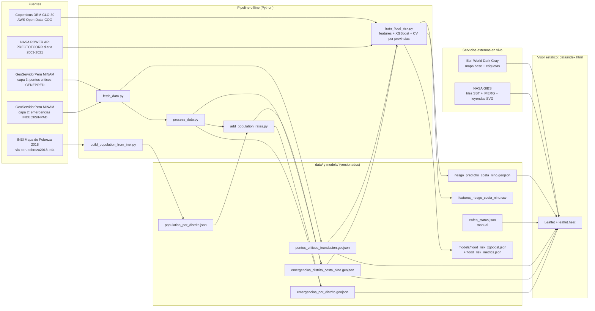

# Mapa de riesgo de inundacion - El Nino Costero 2026-2027 (Peru)

Mapa interactivo (Leaflet) que combina el historial de emergencias por lluvias e inundaciones en Peru, los puntos criticos validados por CENEPRED, condiciones en vivo de NASA GIBS y una capa experimental de riesgo predicho por un modelo de ML (linea base historica, no un pronostico). Es una sola pagina estatica (`data/index.html`), sin backend: el entrenamiento del modelo ocurre fuera del visor y el visor solo lee sus resultados.

**Este mapa no es un aviso oficial.** Avisos oficiales: [SENAMHI](https://www.senamhi.gob.pe/) · [INDECI](https://www.gob.pe/indeci). El historial es contexto (2003-2021), no un reporte en vivo del evento 2026-2027.

## Indice

1. [Arquitectura](#arquitectura)
2. [Capas](#capas)
3. [Fuentes de datos](#fuentes-de-datos)
4. [Pipeline de datos](#pipeline-de-datos)
5. [Modelo de datos](#modelo-de-datos)
6. [Visualizacion y decisiones de diseno](#visualizacion-y-decisiones-de-diseno)
7. [Accesibilidad](#accesibilidad)
8. [Ejecucion local](#ejecucion-local)
9. [Despliegue](#despliegue)
10. [Mantenimiento](#mantenimiento)
11. [Limitaciones y metodologia](#limitaciones-y-metodologia)
12. [Pendientes conocidos](#pendientes-conocidos)
13. [Modelo de riesgo predicho (ML)](#modelo-de-riesgo-predicho-ml)

## Arquitectura

Dos mitades desacopladas: un **pipeline offline** en Python que se corre a mano y deja archivos estaticos en `data/`, y un **visor estatico** (HTML + JS en el navegador) que solo lee esos archivos y consulta servicios publicos de mapas. No hay servidor propio, base de datos ni claves de API.



**Principios de diseno**

- **Estatico y reproducible:** todo lo historico se precalcula; el navegador no agrega ni filtra datos pesados. Los GeoJSON por distrito pesan 0.1-0.8 MB; solo los puntos criticos son grandes (~15.7 MB, 9,964 puntos).
- **Datos fechados, no "en vivo" falsos:** lo unico en vivo son los tiles de NASA. El estado ENFEN vive en un JSON editable con su fecha y se marca como desactualizado pasados 21 dias.
- **Paleta fria deliberada:** amarillo/naranja/rojo/morado/negro quedan reservados al codigo de alerta de SENAMHI; ninguna escala del mapa los usa.
- **Degradacion elegante:** si falla un GeoJSON se muestra un aviso; si falla una leyenda NASA se enlaza a Worldview; si falla `enfen_status.json` la franja enlaza al indice de comunicados.

**Estructura del visor (`data/index.html`)**

| Pieza | Que hace |
| --- | --- |
| Franja superior (`#strip`) | Estado ENFEN fechado (desde `enfen_status.json`) + aviso de no oficial con enlaces a SENAMHI e INDECI. |
| Mapa base | Esri World Dark Gray Base + Reference (etiquetas en un pane propio por encima de las capas). |
| Panes de Leaflet | `labels` (z 650, sin eventos de puntero) > `rates` (z 450, circulos de tasa sobre los puntos CENEPRED) > panes por defecto. |
| Capa nacional | `L.heatLayer` ponderado por `event_count` en log. |
| Capa Costa Norte | `L.heatLayer` + `circleMarker` por distrito coloreado por tasa, con tooltip. |
| Capa CENEPRED | `circleMarker` en un renderer canvas compartido (9,964 puntos) con popup y enlace al PDF. |
| Capas NASA | `L.tileLayer` WMTS (EPSG:3857) con la fecha calculada en el cliente (ver abajo). |
| Panel de capas / leyenda | `<details>` plegables: abiertos en desktop, cerrados en movil; la leyenda de Costa Norte se regenera al cargar los datos. |

## Capas

Historico (archivos estaticos):

1. **Historial nacional de inundaciones:** mapa de calor por distrito, ponderado por numero de eventos (peso log). Apagado por defecto. No es una escala de tasas.
2. **Zona El Nino Costero:** Tumbes, Piura, Lambayeque y La Libertad (199 distritos). Mapa de calor mas circulos por distrito coloreados por tasa de eventos por 1,000 habitantes, con tooltip.
3. **Puntos criticos CENEPRED:** 9,964 puntos con paraje, distrito, rio/quebrada, familias expuestas y enlace al PDF fuente.

Modelo (experimental, apagada por defecto):

4. **Riesgo predicho (ML):** estimacion fuera de muestra, por distrito de la zona Nino Costero, de los eventos por 1,000 habitantes que un modelo XGBoost espera segun precipitacion, elevacion y cercania a puntos criticos. Se dibuja como un anillo terracota alrededor del punto de tasa observada. Es una linea base historica suavizada, **no un pronostico**: ver [Modelo de riesgo predicho (ML)](#modelo-de-riesgo-predicho-ml).

Condiciones en vivo (NASA GIBS, se regeneran a diario):

5. **Anomalia de temperatura superficial del mar** (MUR SST v4.1). Latencia de unos 4 dias; la pagina pide la fecha de hoy menos 5 dias.
6. **Precipitacion** (IMERG, tasa de lluvia). Latencia de aproximadamente 1 dia; la pagina pide la fecha de hoy menos 2 dias.

Cada capa NASA muestra su leyenda oficial (SVG pre-generado de GIBS) solo cuando esta activa.

## Fuentes de datos

| Dato | Fuente | Acceso | Archivo local |
| --- | --- | --- | --- |
| Registro de emergencias (historial 2003-2021, ~121 mil eventos de todo tipo de peligro antes de filtrar) | INDECI / SINPAD, publicado en **GeoServidorPeru (MINAM)**: servicio `hiroambienplanificacion/caracterizacion_territorio_riesgo_desastres`, **capa 2** | ArcGIS REST `MapServer/2/query`, `f=geojson`, paginado de 1,000 | `registro_emergencias_indeci.geojson` (crudo, no versionado) |
| Puntos criticos por inundacion | CENEPRED / SIGRID, publicado en el mismo servicio de GeoServidorPeru (MINAM), **capa 3** | ArcGIS REST `MapServer/3/query`, `f=geojson`, paginado de 1,000 | `puntos_criticos_inundacion.geojson` |
| Poblacion por distrito (campo `pob_2020`, proyeccion INEI a 2020) | INEI, **Mapa de Pobreza Monetaria 2018**, tomado del paquete R [`perupobreza2018`](https://github.com/calderonsamuel/perupobreza2018) (`data/pobreza2018.rda`) | Descarga manual del `.rda` | `population_por_distrito.json` (1,874 distritos) |
| Estado y comunicado ENFEN | **ENFEN**, [comunicados oficiales](https://enfen.imarpe.gob.pe/comunicados/) | Carga manual en JSON | `enfen_status.json` |
| Anomalia TSM | NASA GIBS, capa `GHRSST_L4_MUR_Sea_Surface_Temperature_Anomalies_v4.1_STD` (GHRSST MUR SST v4.1, JPL) | WMTS `gibs.earthdata.nasa.gov/wmts/epsg3857/all`, `GoogleMapsCompatible_Level7` | tiles remotos |
| Precipitacion | NASA GIBS, capa `IMERG_Precipitation_Rate` (GPM IMERG) | WMTS `gibs.earthdata.nasa.gov/wmts/epsg3857/best`, `GoogleMapsCompatible_Level6` | tiles remotos |
| Leyendas NASA | NASA GIBS, SVG pre-generados por familia de colormap (no por id de capa): `GHRSST_Sea_Surface_Temperature_Anomalies_H.svg` y `GPM_Precipitation_Rate_H.svg` | `gibs.earthdata.nasa.gov/legends/` | remoto |
| Precipitacion historica para el modelo (PRECTOTCORR, diaria 2003-2021) | NASA **POWER** (Prediction Of Worldwide Energy Resources), datos MERRA-2 de resolucion nativa (~0.5 x 0.625 grados) | API REST `power.larc.nasa.gov/api/temporal/daily/point`, un pedido por centroide de distrito | `data/features_riesgo_costa_nino.csv` (agregados; la serie diaria cruda queda en una cache local ignorada por git) |
| Elevacion y relieve para el modelo | **Copernicus DEM GLO-30** (30 m), tiles COG en AWS Open Data. Contiene datos modificados de Copernicus: © DLR e.V. y © Airbus Defence and Space GmbH, provistos bajo COPERNICUS por la Union Europea y la ESA | Lectura por rangos HTTP (`rasterio`, `/vsicurl/`) de `copernicus-dem-30m.s3.amazonaws.com` | `data/features_riesgo_costa_nino.csv` |
| Mapa base y etiquetas | Esri, Canvas World Dark Gray (Base y Reference) | Tiles XYZ de `server.arcgisonline.com`, sin clave | remoto |
| Librerias del visor | Leaflet 1.9.4, leaflet.heat 0.2.0 | CDN `unpkg.com` | remoto |

Notas sobre las fuentes:

- El servidor de GeoServidorPeru bloquea el `User-Agent` por defecto de `python-requests`; `fetch_data.py` envia uno de navegador y espera 0.2 s entre paginas.
- El servicio de CENEPRED/SIGRID que consultaba `fetch_population.py` (`Informacion_Complementaria/MapServer/6130400`) **ya no existe**. Por eso la poblacion sale del paquete `perupobreza2018`; el script se conserva solo como referencia.
- El estado ENFEN **no se extrae automaticamente**: se transcribe a mano de los comunicados. Ver [Mantenimiento](#mantenimiento).
- Zona Nino Costero (4 departamentos): criterio geografico basado en la zona de monitoreo Nino 1+2 de ENFEN y en reportes INDECI, no una clasificacion por anos.

## Pipeline de datos

Ejecutar en este orden desde la raiz del proyecto (requiere Python 3, `requests`, `pandas` y `pyreadr`):

1. `fetch_data.py`: descarga las capas 3 (puntos criticos) y 2 (registro de emergencias) de GeoServidorPeru, ya en EPSG:4326, paginando de a 1,000.
2. `process_data.py`:
   - filtra el registro a fenomenos de lluvia e inundacion (`FLOOD_PHENOMENA`: lluvias intensas, inundaciones por desborde de rio/canal/laguna/ruptura de diques, huaycos, deslizamientos, derrumbes, riadas, erosion fluvial, temporales);
   - agrega por `cod_ubigeo` (distrito): numero de eventos, afectados (`safecta`), damnificados (`sdamni`), fallecidos (`sfalle`) y centroide como promedio de las coordenadas de los eventos;
   - marca `region = costa_norte` para Tumbes, Piura, Lambayeque y La Libertad y exporta ese subconjunto como segunda capa;
   - genera `emergencias_inundacion_filtered.geojson` (nivel evento, no versionado, ~76 MB).
3. `build_population_from_inei.py`: genera `population_por_distrito.json` (`{ubigeo: {departamento, provincia, distrito, pob_2020}}`) a partir de `pobreza2018.rda`. Descargar antes ese archivo desde https://github.com/calderonsamuel/perupobreza2018 (`data/pobreza2018.rda`) y guardarlo en `data/`.
4. `add_population_rates.py`: une poblacion por `cod_ubigeo` y agrega `poblacion_2020`, `event_rate_per_1000` y `afectados_rate_per_1000` a las dos capas por distrito. Sin poblacion asociada, los campos quedan en `null` (nunca 0).

5. `train_flood_risk.py` (requiere `pip install -r requirements-ml.txt` y red hacia `power.larc.nasa.gov` y `copernicus-dem-30m.s3.amazonaws.com`): construye features por distrito, valida el modelo, y escribe `data/riesgo_predicho_costa_nino.geojson`, `data/features_riesgo_costa_nino.csv`, `models/flood_risk_xgboost.json` y `models/flood_risk_metrics.json`. La primera corrida consulta NASA POWER (~1 s por distrito, unos 5 minutos en total) y deja las features en el CSV; las siguientes reutilizan el CSV (`--refresh-features` para volver a consultar, `--model lightgbm` para cambiar de modelo). El paso 5 es opcional: el visor solo necesita los archivos de `data/`.

Archivos grandes excluidos del repositorio (`.gitignore`) y regenerables con los scripts: `registro_emergencias_indeci.geojson` (~186 MB), `emergencias_inundacion_filtered.geojson` (~76 MB) y `pobreza2018.rda`.

## Modelo de datos

**`emergencias_por_distrito.geojson`** (1,859 distritos, ~48 mil eventos agregados) y **`emergencias_distrito_costa_nino.geojson`** (199 distritos, ~4.7 mil eventos). Un `Point` por distrito (centroide de sus eventos) con:

| Campo | Significado |
| --- | --- |
| `cod_ubigeo`, `departamento`, `provincia`, `distrito` | Identificacion del distrito. |
| `event_count` | Eventos de lluvia/inundacion 2003-2021. |
| `total_afectados`, `total_damnificados`, `total_fallecidos` | Sumas de impacto. |
| `region` | `costa_norte` u `otro`. |
| `poblacion_2020` | Proyeccion INEI; `null` si no hay match (8 distritos en la capa nacional). |
| `event_rate_per_1000`, `afectados_rate_per_1000` | Tasas acumuladas por 1,000 habitantes; `null` sin poblacion. |

**`puntos_criticos_inundacion.geojson`** (9,964 puntos): atributos de CENEPRED/SIGRID. El visor usa `paraje`, `nom_dist`, `nom_prov`, `nom_dpto`, `nomb_rio_q`, `familias_e` y `url` (PDF fuente).

**`riesgo_predicho_costa_nino.geojson`** (199 distritos): mismos campos que `emergencias_distrito_costa_nino.geojson` mas `riesgo_predicho` (eventos/1000 hab. esperados segun el modelo, prediccion fuera de muestra) y `riesgo_predicho_percentil` (0-100 entre los 199 distritos).

**`features_riesgo_costa_nino.csv`** (199 filas): las 12 features del modelo por `cod_ubigeo`. **`models/`**: modelo final (`flood_risk_xgboost.json`, entrenado con los 199 distritos) y `flood_risk_metrics.json` (metricas, ablaciones, correlaciones con la poblacion, configuracion y semillas).

**`enfen_status.json`**: `estado`, `comunicado`, `fecha` (YYYY-MM-DD), `proximo` (fecha anunciada del siguiente comunicado) y `url`.

## Visualizacion y decisiones de diseno

- **Escala de tasas:** 5 bins iguales en espacio `log1p`, de azul marino a cian palido (L* de ~33 a ~94 en pasos parejos). Cada capa tiene su **propio tope**: la capa nacional conserva el tope de 1,000‰ y Costa Norte usa su maximo real (~31‰, calculado al cargar los datos) para aprovechar los 5 colores. Los colores **no son comparables entre capas**, y las leyendas lo dicen explicitamente.
- **Sin datos:** anillo punteado sin relleno, nunca un color de la rampa, para que no se lea como "seguro". Los distritos sin eventos registrados no estan en el GeoJSON y por tanto no se dibujan; la leyenda aclara que eso no implica ausencia de riesgo.
- **Poblacion pequena:** por debajo de 2,000 habitantes (~p5 de Costa Norte, 11 de 199 distritos) el circulo es mas chico y translucido, se dibuja debajo del resto y el tooltip explica que la tasa es poco estable.
- **Mapas de calor:** peso `log1p(event_count)` normalizado, para que unos pocos distritos extremos no dominen. Nacional en gris pizarra; Costa Norte con la misma familia azul de la rampa.
- **Capas NASA:** fecha calculada en el navegador (UTC, hoy-5 para TSM y hoy-2 para IMERG) segun la latencia de cada producto; opacidad 0.7.
- **Riesgo predicho (ML):** anillo grande (radio 9) en rampa terracota desaturada (L* de 24 a 91 en pasos parejos, saturacion maxima 52%, para que se lea cafe y no como el naranja de alerta), dibujado en un pane propio debajo de los puntos de tasa observada: ambos se leen juntos. Escala propia hasta el maximo predicho (9.2‰), distinta de la de tasas observadas, y la leyenda lo advierte. Apagada por defecto.
- **Puntos CENEPRED:** verde menta para no confundirse con el extremo cian de la escala de tasas.

## Accesibilidad

- Escala verificada con simulacion de deuteranopia y protanopia (Machado et al. 2009): se conserva el orden de luminosidad entre bins (diferencia de color minima ~13.5 entre bins vecinos) y los puntos CENEPRED siguen distinguibles de los azules.
- Contraste del texto de paneles y franja: minimo 6.2:1 (WCAG AA exige 4.5:1).
- La capa ML no depende solo del color: es un anillo grande con borde claro, frente a los puntos chicos de CENEPRED. Bajo deuteranopia/protanopia (simulacion Machado 2009) la menta de CENEPRED y los bins claros de la rampa terracota quedan cerca (ΔE ≈ 10), pero siguen distinguibles por forma y tamano.
- Movil (375 px): panel y leyenda plegables, areas tactiles de al menos 44 px, botones reales con foco visible.
- **Pendiente de verificar en produccion:** la superposicion de los tiles reales de TSM e IMERG con los circulos de tasa bajo daltonismo (DevTools, Rendering, Emulate vision deficiencies). Las pruebas hechas durante el desarrollo no tuvieron los tiles de NASA ni el mapa base cargados.

## Ejecucion local

La pagina carga los GeoJSON con `fetch()`, por lo que debe servirse por HTTP. Abrirla como `file://` no funciona.

```
cd data
python -m http.server 8000
```

Luego abrir http://localhost:8000/index.html

El mapa base es Esri World Dark Gray (gratuito, sin clave). No se requiere ninguna API key. Se necesita red hacia `unpkg.com`, `server.arcgisonline.com` y `gibs.earthdata.nasa.gov`.

## Despliegue

Sitio estatico desplegado en Vercel; cada pull request genera una preview. El `index.html` de la raiz solo redirige a `data/index.html` (se uso asi para GitHub Pages). No hay paso de build: el visor carga Leaflet desde un CDN y los GeoJSON desde `data/`.

## Mantenimiento

- **Estado ENFEN:** ENFEN publica un comunicado cada ~2 semanas. Actualizar `data/enfen_status.json` (`estado`, `comunicado`, `fecha`, `url`) con cada uno; preferir el enlace directo al comunicado en vez del indice. La pagina muestra la fecha prevista del siguiente comunicado (`proximo`) y marca el dato como desactualizado un dia despues de esa fecha (a los 21 dias si falta el campo). Comunicado vigente cargado: N° 19-2026, 30/10/2026, verificado contra el PDF oficial; proximo: 13/11/2026.
- **Datos historicos:** el registro termina en ~2021-12. Para extenderlo hay que volver a correr el pipeline completo cuando MINAM/INDECI publiquen mas fechas.
- **Poblacion:** es proyeccion a 2020. Si INEI publica una proyeccion mas reciente, regenerar `population_por_distrito.json` y volver a correr `add_population_rates.py`.
- **Nombres de leyendas GIBS:** se nombran por familia de colormap, no por id de capa. Si cambian las capas, verificar la URL en `gibs.earthdata.nasa.gov/legends/`.

## Limitaciones y metodologia

- El historial cubre 2003 a 2021-12. Es una linea base historica, no un reporte en vivo del evento 2026-2027.
- Las tasas por 1,000 habitantes son sumas acumuladas de unos 19 anos de eventos distintos, divididas entre la poblacion; no son un porcentaje en un momento dado. Distritos pequenos pueden superar 1,000 por mil. La escala de color es logaritmica y cada capa tiene su propio tope (Costa Norte: su maximo real, ~31 por mil; nacional: 1,000 por mil), por lo que los colores no son comparables entre capas, y los mapas de calor usan peso logaritmico para que los valores extremos no dominen.
- La poblacion es una proyeccion INEI a 2020, no a 2026. Los distritos urbanos de rapido crecimiento quedan subestimados. Ocho distritos de la capa nacional no tienen poblacion asociada y sus tasas son nulas.
- Un solo punto por distrito (centroide de sus eventos): los mapas de calor muestran concentracion por distrito, no la ubicacion exacta de cada evento.
- La zona El Nino Costero es un filtro geografico (cuatro departamentos del norte), no un filtro por anos con El Nino.
- El filtro de fenomenos incluye huaycos, deslizamientos y derrumbes ademas de inundaciones; la capa es de "lluvias e inundaciones" en sentido amplio.

## Pendientes conocidos

- **Paneles que se pisan:** con ventanas de ~600 a 800 px de ancho y los paneles de capas y de leyenda abiertos a la vez, la leyenda tapa el enlace "Metodologia y advertencias". Visto en la preview de Vercel; el movil (hasta 600 px) ya arranca con los paneles plegados.
- **IMERG domina el mapa:** encendida por defecto y con opacidad 0.7, su paleta de NASA (verde, amarillo, rojo) cubre el continente, compite con la escala azul de tasas y puede leerse como alerta. Se evalua apagarla por defecto y bajar su opacidad. La paleta es de NASA y no se puede cambiar.
- **Daltonismo con tiles reales:** sin verificar la superposicion de TSM e IMERG con los circulos de tasa (ver Accesibilidad).
- **Atribucion de Copernicus DEM:** confirmar el texto contra su licencia.
- **Estado ENFEN:** actualizar `data/enfen_status.json` cuando salga el siguiente comunicado (previsto para el 13/11/2026).

## Modelo de riesgo predicho (ML)

Capa experimental, apagada por defecto, que estima para cada uno de los 199 distritos de la zona Nino Costero cuantos eventos de lluvia/inundacion por 1,000 habitantes tendria segun sus condiciones fisicas. **Es una linea base historica suavizada, no un pronostico del evento 2026-2027**: el modelo aprende del mismo historial 2003-2021 y no recibe ninguna informacion del evento actual. Las cifras de esta seccion salen de `models/flood_risk_metrics.json` (generado el 2026-11-10, semilla 42).

**Target.** Regresion sobre `log1p(event_rate_per_1000)`. Un target binario (`event_count > 0`) no es posible: la capa solo contiene distritos con al menos un evento (minimo 1), asi que seria constante. Los distritos sin eventos no estan en el archivo.

**Features** (12, por centroide del distrito):

| Grupo | Features | Fuente |
| --- | --- | --- |
| Precipitacion | `precip_anual_mm`, `precip_p95_mm`, `precip_max_diaria_mm`, `dias_lluvia_fuerte_anual` (dias con >= 10 mm), `precip_max_anual_media_mm`, `precip_cv_anual` | NASA POWER, 2003-2021 (misma ventana que los eventos) |
| Elevacion | `elev_m`, `elev_std_1km` (relieve en ~1 km) | Copernicus DEM GLO-30 |
| CENEPRED | `n_criticos_10km`, `n_criticos_25km`, `dist_critico_km`, `familias_exp_10km` | `puntos_criticos_inundacion.geojson` (BallTree haversine) |

No se usan latitud/longitud (dejarian al modelo memorizar la geografia) ni poblacion (es el denominador del target).

**Modelo.** XGBoost (300 arboles, profundidad 3, tasa de aprendizaje 0.03, regularizacion fuerte), con hiperparametros fijos y sin busqueda: con 199 filas, ajustarlos sobre la misma validacion sobreestimaria el desempeno. Cada fila pesa `log10(poblacion 2020)` porque las tasas de poblaciones chicas son mas ruidosas. Baselines: media constante y Ridge. LightGBM esta disponible con `--model lightgbm`.

**Validacion espacial.** Se dejan provincias completas fuera (26 provincias): distritos vecinos tienen features casi identicas y un split aleatorio los pone a ambos lados, lo que sobreestima el desempeno. CV de 5 folds repetida 20 veces (media ± desviacion entre repeticiones):

| Modelo | RMSE (log) | R² (log) | Spearman |
| --- | --- | --- | --- |
| Media constante | 0.787 ± 0.015 | -0.06 | n/a |
| Ridge | 0.652 ± 0.025 | 0.27 | 0.62 ± 0.04 |
| **XGBoost** | **0.610 ± 0.018** | **0.36** | **0.65 ± 0.03** |
| XGBoost con split aleatorio (referencia optimista) | 0.550 ± 0.015 | 0.48 | 0.75 ± 0.01 |

Un split explicito por provincias (156 distritos de entrenamiento, 43 de prueba en 6 provincias) da RMSE (log) de 0.821 (media), 0.691 (Ridge) y 0.711 (XGBoost); Spearman 0.60 (Ridge) y 0.50 (XGBoost). XGBoost sobreajusta (Spearman 0.97 en entrenamiento): con solo 43 distritos de prueba esa cifra es muy variable y **la CV repetida es la mas confiable**.

**Como leer los resultados.** La mejora sobre la media constante es real pero modesta: el RMSE en escala log baja ~22% y el modelo ordena razonablemente los distritos (Spearman ≈ 0.65). **No predice magnitudes**: el RMSE en ‰ lo dominan unos pocos distritos extremos (con Ridge es incluso peor que predecir la media: 5.9‰ frente a 4.4‰). La diferencia entre la validacion aleatoria (0.75) y la espacial (0.65) mide cuanto inflaria el desempeno una validacion no espacial.

**Ablacion por grupo de features** (XGBoost, CV por provincias x10, Spearman):

| Features | Spearman |
| --- | --- |
| Solo precipitacion | 0.46 ± 0.06 |
| Solo elevacion | 0.55 ± 0.02 |
| Solo CENEPRED | -0.02 ± 0.06 |
| Precipitacion + elevacion (sin CENEPRED) | 0.64 ± 0.03 |
| Todas | 0.64 ± 0.04 |

Las features de CENEPRED **no aportan** poder predictivo: solas no superan el azar y quitarlas no cambia el resultado, aunque el modelo final les asigna ~16% de la importancia (las importancias internas no equivalen a valor predictivo). No se investigo por que; una hipotesis, no verificada, es que los puntos criticos reflejan la cobertura del inventario de CENEPRED mas que la amenaza.

**Salida.** `riesgo_predicho` es la prediccion **fuera de muestra** promediada sobre las 20 repeticiones de la CV, no el ajuste del modelo final a sus propios datos (que seria casi perfecto y engañoso). Va de 0.16‰ a 9.25‰, frente a un maximo observado de 30.98‰: el modelo suaviza los extremos. Por eso la capa tiene su propia escala y paleta, y sus colores no son comparables con los de la tasa observada. El Spearman entre lo observado y lo predicho es 0.67.

**Limitaciones**

- **Confusion con la poblacion.** La tasa es eventos / poblacion, asi que los distritos pequenos tienen tasas altas: Spearman entre tasa y poblacion = -0.77. Los distritos serranos son a la vez pequenos, mas altos (elevacion vs. poblacion: -0.36) y mas lluviosos, asi que el modelo capta en parte "distrito serrano y pequeno" y no solo peligro fisico (predicho vs. poblacion: -0.42). Entre los 64 distritos con >= 20,000 habitantes el Spearman entre lo observado y lo predicho sigue siendo 0.51, de modo que hay senal fuera de los distritos chicos.
- **Muestra pequena:** 199 distritos y 26 provincias; todas las metricas tienen varianza alta.
- **Precipitacion de baja resolucion:** MERRA-2 (~0.5 x 0.625 grados) da solo 35 series distintas para 199 distritos; no distingue microclimas ni la quebrada concreta.
- **Centroide aproximado:** es el promedio de las coordenadas de los eventos del distrito, no el centroide de su poligono; la elevacion y la lluvia en ese punto pueden no representar al distrito, sobre todo en los serranos de gran relieve.
- **Target mezclado:** los "eventos" incluyen huaycos, deslizamientos y derrumbes ademas de inundaciones (ver `FLOOD_PHENOMENA`); la elevacion probablemente se asocia mas con estos que con inundaciones fluviales.
- **Sesgo de seleccion:** solo hay distritos con al menos un evento; el modelo no puede decir "sin riesgo".
- **Subregistro desigual:** INDECI/SINPAD registra segun la capacidad de reporte local; no se controla.
- **Climatologia, no pronostico:** la lluvia es la historica 2003-2021; el modelo no sabe del Nino costero 2026-2027 ni de ningun otro evento en particular.
- **Sin incertidumbre:** no hay intervalos ni probabilidades calibradas por distrito; solo el valor puntual y su percentil.

**Reproducir**

```
pip install -r requirements-ml.txt
python train_flood_risk.py
```

## Fuentes (resumen)

- INDECI / SINPAD, registro de emergencias (via GeoServidorPeru, MINAM).
- CENEPRED / SIGRID, puntos criticos por inundacion (via GeoServidorPeru, MINAM).
- INEI, Mapa de Pobreza Monetaria 2018 (campo `pob_2020`), tomado del paquete `perupobreza2018`.
- ENFEN, comunicados oficiales.
- NASA GIBS: GHRSST MUR SST v4.1 e IMERG, con sus leyendas.
- NASA POWER (MERRA-2), precipitacion diaria 2003-2021, para el modelo de riesgo predicho.
- Copernicus DEM GLO-30 (DLR, Airbus, UE/ESA), elevacion, para el modelo de riesgo predicho.
- Mapa base: Esri.
