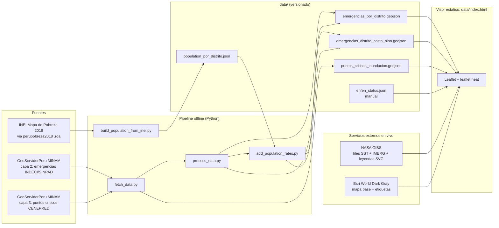

# Mapa de riesgo de inundacion - El Nino Costero 2026-2027 (Peru)

Mapa interactivo (Leaflet) que combina el historial de emergencias por lluvias e inundaciones en Peru, los puntos criticos validados por CENEPRED y condiciones en vivo de NASA GIBS. Es una sola pagina estatica (`data/index.html`), sin backend.

**Este mapa no es un aviso oficial.** Avisos oficiales: [SENAMHI](https://www.senamhi.gob.pe/) · [INDECI](https://www.gob.pe/indeci). El historial es contexto (2003-2021), no un reporte en vivo del evento 2026-2027.

## Indice

1. [Arquitectura](#arquitectura)
2. [Capas](#capas)
3. [Fuentes de datos](#fuentes-de-datos)
4. [Pipeline de datos](#pipeline-de-datos)
5. [Modelo de datos](#modelo-de-datos)
6. [Visualizacion y decisiones de diseno](#visualizacion-y-decisiones-de-diseno)
7. [Accesibilidad](#accesibilidad)
8. [Ejecucion local](#ejecucion-local)
9. [Mantenimiento](#mantenimiento)
10. [Limitaciones y metodologia](#limitaciones-y-metodologia)

## Arquitectura

Dos mitades desacopladas: un **pipeline offline** en Python que se corre a mano y deja archivos estaticos en `data/`, y un **visor estatico** (HTML + JS en el navegador) que solo lee esos archivos y consulta servicios publicos de mapas. No hay servidor propio, base de datos ni claves de API.



**Principios de diseno**

- **Estatico y reproducible:** todo lo historico se precalcula; el navegador no agrega ni filtra datos pesados. Los GeoJSON por distrito pesan 0.1-0.8 MB; solo los puntos criticos son grandes (~15.7 MB, 9,964 puntos).
- **Datos fechados, no "en vivo" falsos:** lo unico en vivo son los tiles de NASA. El estado ENFEN vive en un JSON editable con su fecha y se marca como desactualizado pasados 21 dias.
- **Paleta fria deliberada:** amarillo/naranja/rojo/morado/negro quedan reservados al codigo de alerta de SENAMHI; ninguna escala del mapa los usa.
- **Degradacion elegante:** si falla un GeoJSON se muestra un aviso; si falla una leyenda NASA se enlaza a Worldview; si falla `enfen_status.json` la franja enlaza al indice de comunicados.

**Estructura del visor (`data/index.html`)**

| Pieza | Que hace |
| --- | --- |
| Franja superior (`#strip`) | Estado ENFEN fechado (desde `enfen_status.json`) + aviso de no oficial con enlaces a SENAMHI e INDECI. |
| Mapa base | Esri World Dark Gray Base + Reference (etiquetas en un pane propio por encima de las capas). |
| Panes de Leaflet | `labels` (z 650, sin eventos de puntero) > `rates` (z 450, circulos de tasa sobre los puntos CENEPRED) > panes por defecto. |
| Capa nacional | `L.heatLayer` ponderado por `event_count` en log. |
| Capa Costa Norte | `L.heatLayer` + `circleMarker` por distrito coloreado por tasa, con tooltip. |
| Capa CENEPRED | `circleMarker` en un renderer canvas compartido (9,964 puntos) con popup y enlace al PDF. |
| Capas NASA | `L.tileLayer` WMTS (EPSG:3857) con la fecha calculada en el cliente (ver abajo). |
| Panel de capas / leyenda | `<details>` plegables: abiertos en desktop, cerrados en movil; la leyenda de Costa Norte se regenera al cargar los datos. |

## Capas

Historico (archivos estaticos):

1. **Historial nacional de inundaciones:** mapa de calor por distrito, ponderado por numero de eventos (peso log). Apagado por defecto. No es una escala de tasas.
2. **Zona El Nino Costero:** Tumbes, Piura, Lambayeque y La Libertad (199 distritos). Mapa de calor mas circulos por distrito coloreados por tasa de eventos por 1,000 habitantes, con tooltip.
3. **Puntos criticos CENEPRED:** 9,964 puntos con paraje, distrito, rio/quebrada, familias expuestas y enlace al PDF fuente.

Condiciones en vivo (NASA GIBS, se regeneran a diario):

4. **Anomalia de temperatura superficial del mar** (MUR SST v4.1). Latencia de unos 4 dias; la pagina pide la fecha de hoy menos 5 dias.
5. **Precipitacion** (IMERG, tasa de lluvia). Latencia de aproximadamente 1 dia; la pagina pide la fecha de hoy menos 2 dias.

Cada capa NASA muestra su leyenda oficial (SVG pre-generado de GIBS) solo cuando esta activa.

## Fuentes de datos

| Dato | Fuente | Acceso | Archivo local |
| --- | --- | --- | --- |
| Registro de emergencias (historial 2003-2021, ~121 mil eventos de todo tipo de peligro antes de filtrar) | INDECI / SINPAD, publicado en **GeoServidorPeru (MINAM)**: servicio `hiroambienplanificacion/caracterizacion_territorio_riesgo_desastres`, **capa 2** | ArcGIS REST `MapServer/2/query`, `f=geojson`, paginado de 1,000 | `registro_emergencias_indeci.geojson` (crudo, no versionado) |
| Puntos criticos por inundacion | CENEPRED / SIGRID, publicado en el mismo servicio de GeoServidorPeru (MINAM), **capa 3** | ArcGIS REST `MapServer/3/query`, `f=geojson`, paginado de 1,000 | `puntos_criticos_inundacion.geojson` |
| Poblacion por distrito (campo `pob_2020`, proyeccion INEI a 2020) | INEI, **Mapa de Pobreza Monetaria 2018**, tomado del paquete R [`perupobreza2018`](https://github.com/calderonsamuel/perupobreza2018) (`data/pobreza2018.rda`) | Descarga manual del `.rda` | `population_por_distrito.json` (1,874 distritos) |
| Estado y comunicado ENFEN | **ENFEN**, [comunicados oficiales](https://enfen.imarpe.gob.pe/comunicados/) | Carga manual en JSON | `enfen_status.json` |
| Anomalia TSM | NASA GIBS, capa `GHRSST_L4_MUR_Sea_Surface_Temperature_Anomalies_v4.1_STD` (GHRSST MUR SST v4.1, JPL) | WMTS `gibs.earthdata.nasa.gov/wmts/epsg3857/all`, `GoogleMapsCompatible_Level7` | tiles remotos |
| Precipitacion | NASA GIBS, capa `IMERG_Precipitation_Rate` (GPM IMERG) | WMTS `gibs.earthdata.nasa.gov/wmts/epsg3857/best`, `GoogleMapsCompatible_Level6` | tiles remotos |
| Leyendas NASA | NASA GIBS, SVG pre-generados por familia de colormap (no por id de capa): `GHRSST_Sea_Surface_Temperature_Anomalies_H.svg` y `GPM_Precipitation_Rate_H.svg` | `gibs.earthdata.nasa.gov/legends/` | remoto |
| Mapa base y etiquetas | Esri, Canvas World Dark Gray (Base y Reference) | Tiles XYZ de `server.arcgisonline.com`, sin clave | remoto |
| Librerias del visor | Leaflet 1.9.4, leaflet.heat 0.2.0 | CDN `unpkg.com` | remoto |

Notas sobre las fuentes:

- El servidor de GeoServidorPeru bloquea el `User-Agent` por defecto de `python-requests`; `fetch_data.py` envia uno de navegador y espera 0.2 s entre paginas.
- El servicio de CENEPRED/SIGRID que consultaba `fetch_population.py` (`Informacion_Complementaria/MapServer/6130400`) **ya no existe**. Por eso la poblacion sale del paquete `perupobreza2018`; el script se conserva solo como referencia.
- El estado ENFEN **no se extrae automaticamente**: se transcribe a mano de los comunicados. Ver [Mantenimiento](#mantenimiento).
- Zona Nino Costero (4 departamentos): criterio geografico basado en la zona de monitoreo Nino 1+2 de ENFEN y en reportes INDECI, no una clasificacion por anos.

## Pipeline de datos

Ejecutar en este orden desde la raiz del proyecto (requiere Python 3, `requests`, `pandas` y `pyreadr`):

1. `fetch_data.py`: descarga las capas 3 (puntos criticos) y 2 (registro de emergencias) de GeoServidorPeru, ya en EPSG:4326, paginando de a 1,000.
2. `process_data.py`:
   - filtra el registro a fenomenos de lluvia e inundacion (`FLOOD_PHENOMENA`: lluvias intensas, inundaciones por desborde de rio/canal/laguna/ruptura de diques, huaycos, deslizamientos, derrumbes, riadas, erosion fluvial, temporales);
   - agrega por `cod_ubigeo` (distrito): numero de eventos, afectados (`safecta`), damnificados (`sdamni`), fallecidos (`sfalle`) y centroide como promedio de las coordenadas de los eventos;
   - marca `region = costa_norte` para Tumbes, Piura, Lambayeque y La Libertad y exporta ese subconjunto como segunda capa;
   - genera `emergencias_inundacion_filtered.geojson` (nivel evento, no versionado, ~76 MB).
3. `build_population_from_inei.py`: genera `population_por_distrito.json` (`{ubigeo: {departamento, provincia, distrito, pob_2020}}`) a partir de `pobreza2018.rda`. Descargar antes ese archivo desde https://github.com/calderonsamuel/perupobreza2018 (`data/pobreza2018.rda`) y guardarlo en `data/`.
4. `add_population_rates.py`: une poblacion por `cod_ubigeo` y agrega `poblacion_2020`, `event_rate_per_1000` y `afectados_rate_per_1000` a las dos capas por distrito. Sin poblacion asociada, los campos quedan en `null` (nunca 0).

Archivos grandes excluidos del repositorio (`.gitignore`) y regenerables con los scripts: `registro_emergencias_indeci.geojson` (~186 MB), `emergencias_inundacion_filtered.geojson` (~76 MB) y `pobreza2018.rda`.

## Modelo de datos

**`emergencias_por_distrito.geojson`** (1,859 distritos, ~48 mil eventos agregados) y **`emergencias_distrito_costa_nino.geojson`** (199 distritos, ~4.7 mil eventos). Un `Point` por distrito (centroide de sus eventos) con:

| Campo | Significado |
| --- | --- |
| `cod_ubigeo`, `departamento`, `provincia`, `distrito` | Identificacion del distrito. |
| `event_count` | Eventos de lluvia/inundacion 2003-2021. |
| `total_afectados`, `total_damnificados`, `total_fallecidos` | Sumas de impacto. |
| `region` | `costa_norte` u `otro`. |
| `poblacion_2020` | Proyeccion INEI; `null` si no hay match (8 distritos en la capa nacional). |
| `event_rate_per_1000`, `afectados_rate_per_1000` | Tasas acumuladas por 1,000 habitantes; `null` sin poblacion. |

**`puntos_criticos_inundacion.geojson`** (9,964 puntos): atributos de CENEPRED/SIGRID. El visor usa `paraje`, `nom_dist`, `nom_prov`, `nom_dpto`, `nomb_rio_q`, `familias_e` y `url` (PDF fuente).

**`enfen_status.json`**: `estado`, `comunicado`, `fecha` (YYYY-MM-DD) y `url`.

## Visualizacion y decisiones de diseno

- **Escala de tasas:** 5 bins iguales en espacio `log1p`, de azul marino a cian palido (L* de ~33 a ~94 en pasos parejos). Cada capa tiene su **propio tope**: la capa nacional conserva el tope de 1,000‰ y Costa Norte usa su maximo real (~31‰, calculado al cargar los datos) para aprovechar los 5 colores. Los colores **no son comparables entre capas**, y las leyendas lo dicen explicitamente.
- **Sin datos:** anillo punteado sin relleno, nunca un color de la rampa, para que no se lea como "seguro". Los distritos sin eventos registrados no estan en el GeoJSON y por tanto no se dibujan; la leyenda aclara que eso no implica ausencia de riesgo.
- **Poblacion pequena:** por debajo de 2,000 habitantes (~p5 de Costa Norte, 11 de 199 distritos) el circulo es mas chico y translucido, se dibuja debajo del resto y el tooltip explica que la tasa es poco estable.
- **Mapas de calor:** peso `log1p(event_count)` normalizado, para que unos pocos distritos extremos no dominen. Nacional en gris pizarra; Costa Norte con la misma familia azul de la rampa.
- **Capas NASA:** fecha calculada en el navegador (UTC, hoy-5 para TSM y hoy-2 para IMERG) segun la latencia de cada producto; opacidad 0.7.
- **Puntos CENEPRED:** verde menta para no confundirse con el extremo cian de la escala de tasas.

## Accesibilidad

- Escala verificada con simulacion de deuteranopia y protanopia (Machado et al. 2009): se conserva el orden de luminosidad entre bins (diferencia de color minima ~13.5 entre bins vecinos) y los puntos CENEPRED siguen distinguibles de los azules.
- Contraste del texto de paneles y franja: minimo 6.2:1 (WCAG AA exige 4.5:1).
- Movil (375 px): panel y leyenda plegables, areas tactiles de al menos 44 px, botones reales con foco visible.
- **Pendiente de verificar en produccion:** la superposicion de los tiles reales de TSM e IMERG con los circulos de tasa bajo daltonismo (DevTools, Rendering, Emulate vision deficiencies). Las pruebas hechas durante el desarrollo no tuvieron los tiles de NASA ni el mapa base cargados.

## Ejecucion local

La pagina carga los GeoJSON con `fetch()`, por lo que debe servirse por HTTP. Abrirla como `file://` no funciona.

```
cd data
python -m http.server 8000
```

Luego abrir http://localhost:8000/index.html

El mapa base es Esri World Dark Gray (gratuito, sin clave). No se requiere ninguna API key. Se necesita red hacia `unpkg.com`, `server.arcgisonline.com` y `gibs.earthdata.nasa.gov`.

## Mantenimiento

- **Estado ENFEN:** ENFEN publica un comunicado cada ~2 semanas. Actualizar `data/enfen_status.json` (`estado`, `comunicado`, `fecha`, `url`) con cada uno; preferir el enlace directo al comunicado en vez del indice. Pasados 21 dias la pagina marca el dato como posiblemente desactualizado.
- **Datos historicos:** el registro termina en ~2021-12. Para extenderlo hay que volver a correr el pipeline completo cuando MINAM/INDECI publiquen mas fechas.
- **Poblacion:** es proyeccion a 2020. Si INEI publica una proyeccion mas reciente, regenerar `population_por_distrito.json` y volver a correr `add_population_rates.py`.
- **Nombres de leyendas GIBS:** se nombran por familia de colormap, no por id de capa. Si cambian las capas, verificar la URL en `gibs.earthdata.nasa.gov/legends/`.

## Limitaciones y metodologia

- El historial cubre 2003 a 2021-12. Es una linea base historica, no un reporte en vivo del evento 2026-2027.
- Las tasas por 1,000 habitantes son sumas acumuladas de unos 19 anos de eventos distintos, divididas entre la poblacion; no son un porcentaje en un momento dado. Distritos pequenos pueden superar 1,000 por mil. La escala de color es logaritmica y cada capa tiene su propio tope (Costa Norte: su maximo real, ~31 por mil; nacional: 1,000 por mil), por lo que los colores no son comparables entre capas, y los mapas de calor usan peso logaritmico para que los valores extremos no dominen.
- La poblacion es una proyeccion INEI a 2020, no a 2026. Los distritos urbanos de rapido crecimiento quedan subestimados. Ocho distritos de la capa nacional no tienen poblacion asociada y sus tasas son nulas.
- Un solo punto por distrito (centroide de sus eventos): los mapas de calor muestran concentracion por distrito, no la ubicacion exacta de cada evento.
- La zona El Nino Costero es un filtro geografico (cuatro departamentos del norte), no un filtro por anos con El Nino.
- El filtro de fenomenos incluye huaycos, deslizamientos y derrumbes ademas de inundaciones; la capa es de "lluvias e inundaciones" en sentido amplio.

## Fuentes (resumen)

- INDECI / SINPAD, registro de emergencias (via GeoServidorPeru, MINAM).
- CENEPRED / SIGRID, puntos criticos por inundacion (via GeoServidorPeru, MINAM).
- INEI, Mapa de Pobreza Monetaria 2018 (campo `pob_2020`), tomado del paquete `perupobreza2018`.
- ENFEN, comunicados oficiales.
- NASA GIBS: GHRSST MUR SST v4.1 e IMERG, con sus leyendas.
- Mapa base: Esri.
